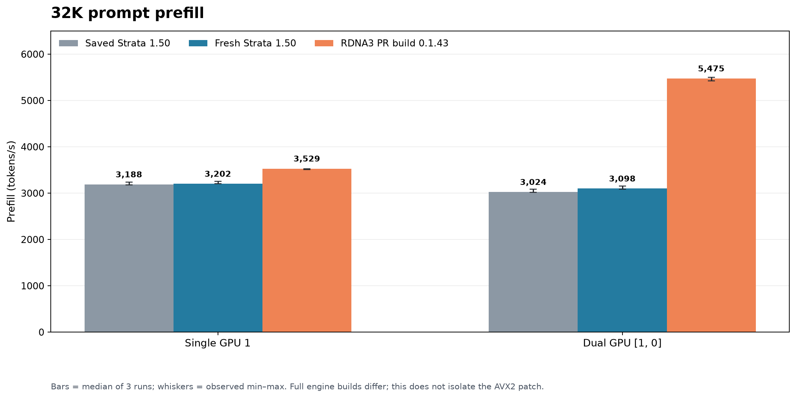
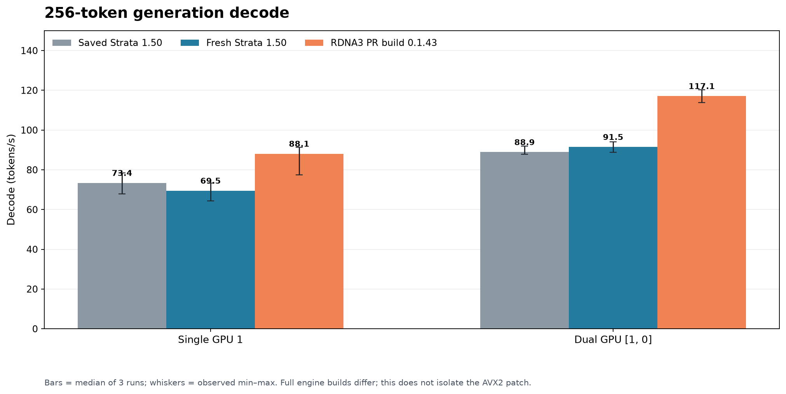

# AVX2-host check and Strata benchmark comparison

**Run date:** 2026-10-26. **PR source:** `dc6c8edd51e17166e2c7d7aa9032922b9d1f429a` (`fix/avx2-safe-isa-probe`).

This report adds a real-host check for the AVX2-safe CPU feature probe and compares the RDNA3 branch build with the installed Strata 0.1.50 engine. The benchmark compares complete engine builds; it does not isolate the AVX2 probe patch as a speed change.

## Test host and method

- Ryzen 9 3900X (Zen 2, AVX2; no AVX-512), 125 GiB detected system memory, two RX 7900 XTX 24 GiB cards, ROCm 10.1.0.
- Requests went to `http://127.0.0.1:8080/v1/chat/completions`. Speeds are the engine-reported `timings.prompt_per_second` and `timings.predicted_per_second` fields returned by the API, not estimates read from the monitor.
- The test used the Swift 1.5 Qwen3.8-Flash-Next Abliterated IQ3_S model and its existing pack/MTP files. Each run used an uncached 32,768-token prompt, a 256-token output cap, temperature 0, seed 42, thinking disabled, and one 128-token warm-up before three measured requests. The local prompt corpus is `rdna3-validation/prompts.json`; the request and timing method follows `rdna3/bench.py`.
- Each measured request was checked for exactly 32,768 input tokens, zero cached tokens, exactly 256 output tokens, all three embedded retrieval codes, nonempty text, no replacement character, and no standalone `NaN` token. Every run in the table passed.
- “Saved 1.50” is the earlier checked-in local result from `rdna3-validation/results/baseline-{1gpu,2gpu}.json` (engine logs identify 0.1.50). The fresh 1.50 and PR-build runs below were made sequentially on port 8080 on the report date.

## Results

Rates are tokens/second. Ranges show the lowest and highest of the three measured runs; the median is the headline result.

| Setup | Earlier saved Strata 1.50 median (prefill / decode) | Fresh Strata 1.50 median (range) | RDNA3 PR build 0.1.43 median (range) | PR build vs fresh 1.50 |
|---|---:|---:|---:|---:|
| Single, GPU 1 | 3,188.1 / 73.4 | 3,201.8 (3,200.9–3,253.7) / 69.5 (64.3–73.4) | 3,529.4 (3,505.5–3,529.9) / 88.1 (77.5–91.3) | +10.2% prefill / +26.8% decode |
| Dual, GPU order `[1, 0]` | 3,024.3 / 88.9 | 3,098.1 (3,087.0–3,155.3) / 91.5 (88.7–94.1) | 5,474.6 (5,426.0–5,502.8) / 117.1 (113.9–120.3) | +76.7% prefill / +28.0% decode |

The raw three-run measurements, validation results, normalized launch arguments, environment values, and binary hashes are in [`2026-10-26-avx2-compatibility-results.json`](2026-10-26-avx2-compatibility-results.json).

The fresh 1.50 logs warned that free VRAM at request start fell below the configured 512 MiB reserve (388 MiB on the single-GPU run and 480 MiB on the dual-GPU run). All measured requests still completed and passed the checks above; the warnings mean those runs had little spare VRAM margin.

## Tested launch settings

The same preset was used for each engine version within a GPU mode. The engine executable and working directory changed; the expert-profile paths differed between checkouts, but the profile files had identical contents. The full sanitized argument and environment lists are in the JSON artifact.

| Mode | GPU / split | Command-line settings that affect this run | Environment settings relevant to the path |
|---|---|---|---|
| Single | `[1]`, `layer_split=auto` | IQ3_S pack/model, `--prefill auto`, `--spec 4 --spec-min-p 0.5`, MTP `rt`, `--max-context 262144`, `--kv int8`, `--ple-io direct`, `--expert-cache auto`, `--ple-row-cache 1048576`, `--kv-resident 32768`, `--pcie-frac 0`, `--vram-reserve-mib 512`, `--pool-workers 12`, `--mtp-q4 all --mtp-window 4096` | `STRATA_PEER_TRANSPORT=host`, `STRATA_PREFILL_RING=192`, `STRATA_PREFILL_CPU_SHARE=auto`, `STRATA_PREFILL_CPU_SHARE_MAX=6144`, `GPU_MAX_HW_QUEUES=6`; the HIPBLASLt gfx1100 tuning file and RDNA WMMA/prefill switches are recorded in the JSON. |
| Dual | `[1, 0]`, `layer_split=24` | Same model/pack and context; `--prefill auto`, `--spec 3 --spec-min-p 0.5`, `--pipeline-windows 2`, `--kv int8`, `--ple-io direct`, `--expert-cache auto`, `--ple-row-cache 1048576`, `--kv-resident 32768`, `--pcie-frac 0`, `--vram-reserve-mib 512 --vram-reserve-later-mib 2048`, `--pool-workers 8`, `--mtp-q4 all --mtp-window 4096` | `STRATA_PEER_TRANSPORT=host`, `STRATA_PREFILL_RING=384`, `STRATA_PREFILL_CPU_SHARE=auto`, `STRATA_PREFILL_CPU_SHARE_MAX=1024`, `GPU_MAX_HW_QUEUES=8`, `STRATA_DP_PREFILL=1`; all remaining switches are recorded in the JSON. The later-GPU reserve leaves 2 GiB on GPU 0 for the display. |

The single- and dual-GPU presets have different worker, speculative-decoding, prompt-ring, and CPU-share settings. Their results are useful for comparing the presets, but they do not isolate GPU count as the only changed variable. The official 1.50 and PR build were compared using the same preset within each mode.

## Why Strata 1.50 single- and dual-GPU prefill are close

This result does not by itself indicate a broken GPU or a failed two-card setup. The fresh 1.50 dual run is about 3.2% below the single-GPU prefill median; the earlier saved results show the same pattern, about 5.1% lower on dual.

Strata 1.50 is using a **layer split** here: its log assigns layers 0–23 to GPU 0 and layers 24–47 to GPU 1, with a hand-off between the stages. Both GPUs do not independently process separate prompt chunks in this path. The 1.50 log also says adaptive overlap is off for this layer split. The dual configuration sets `STRATA_DP_PREFILL=1`, but the 1.50 log does not report the RDNA3 fork's DP prompt path as enabled. The PR-branch log does report that path on and says long prompts read both GPUs on alternating chunks. That fork-specific prompt path is a plausible major reason its dual prefill is higher; the benchmark also compares different engine versions and other RDNA3 changes, so this difference cannot be attributed to the AVX2 patch.

## What this says about the PR

The CPU has no AVX-512, and both engines report using their AVX2 fallback on this host. The PR change keeps the AVX-512 kernels and makes the relevant initialization/probe safe on AVX2-only CPUs. It adds no new AVX2 kernel, and this benchmark does not show that the probe patch itself makes inference faster.

The PR build was engine 0.1.43 from the RDNA3 branch, while the control was official Strata 0.1.50. The RDNA3 branch contains independent GPU and prompt-path work. The performance columns therefore document these tested builds on this machine; they are not a controlled before/after speed claim for the AVX2 patch.
